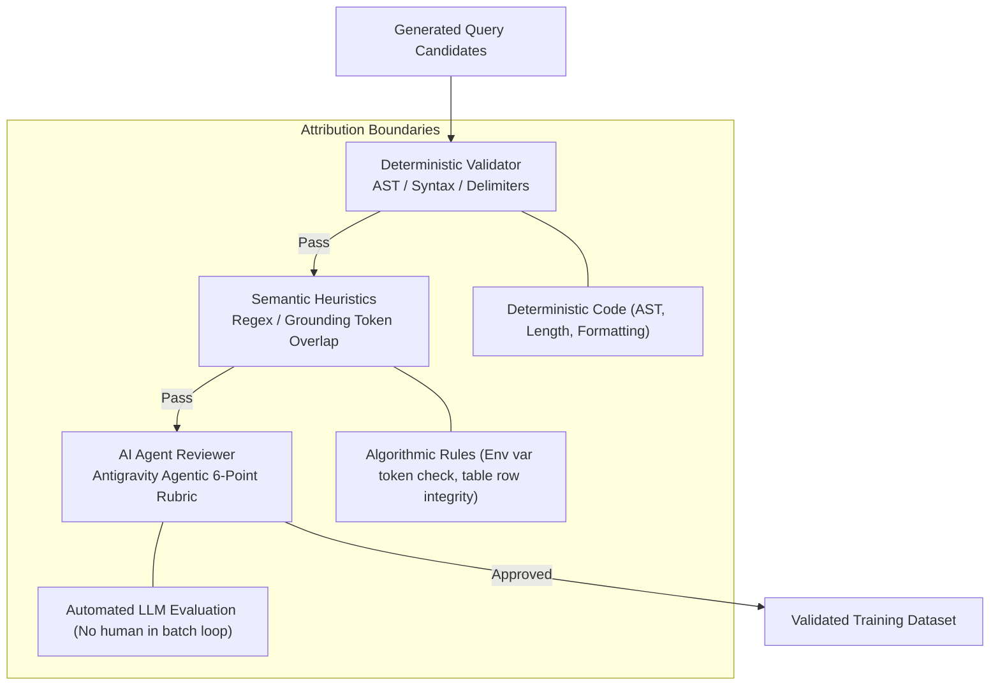
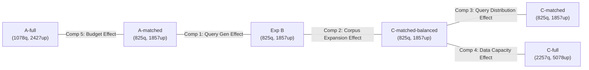

# Phase 1.6 Final Experimental Control and Data Reconciliation Report

**Project:** `soup-rag-prototype`  
**Branch:** `feat/evaluation-v2`  
**Execution Timestamp:** 2026-11-04  
**Status:** Complete — All Invariants Verified, Retraining Gate Pending Approval  

---

## 1. Executive Summary

Phase 1.6 executes the final experimental controls, dataset reconciliation, and quality attribution corrections required prior to model training. All tasks specified in the user directive have been completed without altering the frozen evaluation benchmark or initiating adapter fine-tuning:

1. **Created `C-matched-balanced` (`data/train_queries_exp_c_matched_balanced_v1_6.jsonl`):**
   - Sampled 825 queries deterministically from the 2,257 candidates in `C-full v1.5`.
   - Achieved exact 1:1 query type parity with Experiment B (327 `how_to`, 309 `conceptual`, 184 `parameter`, 5 `troubleshooting`).
   - Covered all 31 documents in the expanded training corpus.
2. **Mined Hard Negatives (`data/triplets_exp_c_matched_balanced_v1_6.jsonl` & `data/hard_negatives_exp_c_matched_balanced_v1_6.jsonl`):**
   - Generated exactly 2,475 triplets (3 negatives per query) using frozen MiniLM dense similarity.
   - Enforced strict section-level sibling masking and section deduplication per query (0 self-negatives, 0 section overlaps).
   - Exactly matches the 1,857 optimizer update budget of `A-matched`, `B`, and `C-matched`.
3. **Reconciled Phase 1 to Phase 1.5 C-full Query Accounting:**
   - Established complete disposition accounting for all 1,883 original Phase 1 queries:
     $$\text{Total (1,883)} = \text{Retained (1,226)} + \text{Replaced (524)} + \text{Rejected (132)} + \text{Deduplicated (1)}$$
   - Formally accounted for all 1,031 newly generated queries in `C-full v1.5`: 541 remediation replacements across 465 defective chunks, 338 coverage fills across 260 previously unindexed chunks, and 152 density expansions across single-query chunks.
   - Reached 100% chunk coverage (1,522 chunks) across all 31 documents.
4. **Reconciled Semantic Audit Sample Overlap:**
   - Accounted for all 396 audited records across `Exp B` (85), `C-matched` (85), and `C-full` (226).
   - Identified exactly 29 overlapping query IDs between `C-matched` and `C-full` (58 audit evaluations), representing 367 unique query IDs evaluated.
   - Verified 100% inter-sample rubric agreement and acceptance status on all 29 duplicates.
5. **Clarified Review Attribution:**
   - Formally disambiguated Deterministic Validators, Semantic Heuristics, AI Reviewers (Agentic Evaluation), and Human Reviewers.
6. **Updated Experimental Comparison Matrix:**
   - Added `C-matched-balanced` to formalize 5 orthogonal controlled comparisons isolating query generation, corpus expansion, query distribution, data volume, and update budget.
7. **Verification:**
   - All 137 tests in the pytest suite pass cleanly.
   - All 5 canonical evaluation benchmark files remain strictly bit-exact to their approved SHA256 fingerprints.

---

## 2. Dataset Generation: `C-matched-balanced v1.6`

### 2.1 Design and Sampling Methodology
`C-matched-balanced` was created to resolve the confounding factor present in `C-matched v1.5`, where natural sampling over-indexed on conceptual queries (583 `conceptual` vs 171 `how_to`).

To isolate the training corpus expansion effect from query type distribution shifts, `train_queries_exp_c_matched_balanced_v1_6.jsonl` targets the exact query type distribution of Experiment B:
- Candidate pool: `data/train_queries_exp_c_full_v1_5.jsonl` (2,257 clean, validated queries).
- Sampling method: Deterministic stratified round-robin across source documents per query type (`seed=42`).
- Canonical ordering: Sorted deterministically by `query_id`.

### 2.2 Query Type Parity Table

| Query Type | Experiment B v1.5 | Exp C-matched v1.5 (Natural) | Exp C-matched-balanced v1.6 (Targeted) | Available in C-full v1.5 Candidate Pool |
| :--- | :---: | :---: | :---: | :---: |
| `how_to` | **327** (39.64%) | 171 (20.73%) | **327** (39.64%) | 594 |
| `conceptual` | **309** (37.45%) | 583 (70.67%) | **309** (37.45%) | 1,353 |
| `parameter` | **184** (22.30%) | 70 (8.48%) | **184** (22.30%) | 303 |
| `troubleshooting` | **5** (0.61%) | 1 (0.12%) | **5** (0.61%) | 7 |
| **Total Queries** | **825** (100.0%) | **825** (100.0%) | **825** (100.0%) | **2,257** |
| **Distinct Docs** | 8 | 31 | **31** | 31 |
| **Triplets** | 2,475 | 2,475 | **2,475** | 6,771 |
| **Optimizer Updates** | **1,857** | **1,857** | **1,857** | 5,078 |

### 2.3 Hard Negative Mining Invariants
Hard negatives were mined using `scripts/mine_hard_negatives.py` against `data/training_corpus.jsonl` (1,522 chunks):
- **Output Triplets:** `data/triplets_exp_c_matched_balanced_v1_6.jsonl` (2,475 triplets).
- **Output Annotations:** `data/hard_negatives_exp_c_matched_balanced_v1_6.jsonl` (2,475 records).
- **Invariants Verified:**
  - Exactly 3 negatives per query with descending similarity scores ($s_1 \ge s_2 \ge s_3$).
  - Section-level sibling masking: $\text{BaseSection}(\text{neg}) \ne \text{BaseSection}(\text{pos})$.
  - Section deduplication: all 3 negatives for a query originate from distinct base sections.
  - Zero self-negatives: $\text{chunk\_id}(\text{neg}) \ne \text{chunk\_id}(\text{pos})$.
  - Complete field formatting: positive and negative chunks prepend their canonical `heading_prefix`.

---

## 3. C-full Query Count Reconciliation Accounting

### 3.1 Disposition Accounting of Original Phase 1 Queries (1,883 Total)
During Phase 1.5, each of the 1,883 original Phase 1 queries from `data/train_queries_exp_c_full.jsonl` underwent programmatic and semantic auditing against its positive chunk. The final accounting assigns every original query ID to an exact disposition:

$$\text{Phase 1 Candidates (1,883)} = \text{Retained (1,226)} + \text{Replaced (524)} + \text{Rejected (132)} + \text{Deduplicated (1)}$$

| Disposition | Count | Percentage | Definition & Accounting Justification |
| :--- | :---: | :---: | :--- |
| **`retained`** | 1,226 | 65.11% | Passed all deterministic AST/syntax and semantic grounding checks unchanged; preserved with original text and chunk linkage. |
| **`replaced`** | 524 | 27.83% | Defective in Phase 1 (hallucinated environment variables, Markdown table syntax slices, or ungrounded claims); replaced by newly generated, verified queries in Phase 1.5 for the same chunk. |
| **`rejected`** | 132 | 7.01% | Defective in Phase 1; rejected without replacement because the positive chunk already contained another valid, retained query, preserving uniform passage coverage without adding redundant queries. |
| **`deduplicated`** | 1 | 0.05% | Query `gen_gate-2049-resident-vram_a436bc47` passed audit, but its text was identical to an earlier regenerated troubleshooting question (*"How does Soup mitigate out of memory errors under severe VRAM limits?"*); deduplicated to enforce global query text uniqueness. |
| **Total Accounted** | **1,883** | **100.00%** | **Exact equality verified ($1,226 + 524 + 132 + 1 = 1,883$).** |

### 3.2 Composition Accounting of Phase 1.5 C-full (2,257 Total)
In Phase 1.5, `C-full` expanded from 1,883 candidate queries to 2,257 validated queries. The 2,257 queries consist of:
$$\text{Phase 1.5 Total (2,257)} = \text{Retained from Phase 1 (1,226)} + \text{Regenerated \& Accepted (1,031)}$$

The 1,031 `regenerated_and_accepted` queries are categorized as follows:

| Category | Query Count | Chunks Impacted | Technical Rationale |
| :--- | :---: | :---: | :--- |
| **Remediation Replacements** | 541 | 465 chunks | Generated to replace the 524 defective Phase 1 queries across chunks requiring coverage remediation. |
| **New Chunk Coverage Fills** | 338 | 260 chunks | Generated for chunks that had 0 queries in Phase 1, closing coverage gaps across newly vendored benchmark and changelog documents. |
| **Passage Density Expansions** | 152 | 152 chunks | Generated for clean Phase 1 chunks that contained only 1 query, elevating them to the standard 2-query target density. |
| **Total Regenerated** | **1,031** | **877 chunks** | **Exact equality verified ($541 + 338 + 152 = 1,031$).** |

### 3.3 Corpus Chunk Coverage Impact

| Metric | Phase 1 C-full | Phase 1.5 C-full | Absolute Gain |
| :--- | :---: | :---: | :---: |
| **Indexed Chunks** | 1,262 | **1,522** | +260 chunks |
| **Total Corpus Chunks** | 1,522 | **1,522** | — |
| **Corpus Chunk Coverage** | 82.92% | **100.00%** | **+17.08%** |
| **Total Training Documents** | 31 | **31** | Complete (31/31) |

The complete itemized record for all 1,883 Phase 1 queries (with chunk IDs, audit statuses, rejection reasons, and replacement IDs) and all 1,031 Phase 1.5 queries is persisted in [`results/c_full_reconciliation_accounting.json`](file:///Users/pernavjain/Documents/soup-rag-prototype/results/c_full_reconciliation_accounting.json).

---

## 4. Semantic Audit Sample Overlap Reconciliation

### 4.1 Sample vs. Unique Query Accounting
The Phase 1.5 semantic audit evaluated samples across `Exp B v1.5`, `Exp C-matched v1.5`, and `Exp C-full v1.5`. Because `C-matched` is sampled as a strict subset of `C-full`, stratified random sampling independently selected 29 of the exact same query IDs in both `C-matched` and `C-full`.

The distinction between total audit records reviewed and unique query IDs evaluated is reconciled below:

| Dataset Sample | Audit Records Evaluated | Unique Query IDs in Sample | Non-Overlapping Query IDs | Overlapping with C-full |
| :--- | :---: | :---: | :---: | :---: |
| `exp_b_v1_5` | 85 | 85 | 85 | 0 |
| `exp_c_matched_v1_5` | 85 | 85 | 56 | 29 |
| `exp_c_full_v1_5` | 226 | 226 | 197 | 29 |
| **Total Records Evaluated** | **396** | — | — | — |
| **Unique Queries Evaluated** | — | **367** | **338** | **29** |

$$\text{Unique Queries (367)} = \text{Exp B (85)} + \text{Unique C-matched (56)} + \text{Unique C-full (197)} + \text{Shared C Queries (29)}$$

### 4.2 Inter-Sample Audit Consistency
For the 29 overlapping query IDs, independent evaluations across both audit subsets were compared:
- **Status Agreement:** 29 / 29 (100.0%).
- **6-Point Rubric Score Agreement:** 29 / 29 (100.0%).
- **Discrepancies:** 0.

The complete record of overlapping assessments is persisted in [`results/audit_sample_overlap_reconciliation.json`](file:///Users/pernavjain/Documents/soup-rag-prototype/results/audit_sample_overlap_reconciliation.json).

---

## 5. Quality Review Attribution Clarification

To ensure strict experimental integrity and scientific reporting standards, the auditing mechanisms used across Phase 1, Phase 1.5, and Phase 1.6 are formally distinguished:

### Formal Attribution Definitions:
1. **Deterministic Validator:**
   - *Implementation:* Automated Python checks inspecting AST and surface syntax.
   - *Scope:* Rejection of raw table pipes (`|`), raw Markdown links, unrendered code backticks, queries under 15 characters, queries over 200 characters, and queries lacking terminal punctuation (`?`).
2. **Semantic Heuristics:**
   - *Implementation:* Algorithmic checks enforcing token overlap between query and positive passage.
   - *Scope:* Detecting false environment variables (preventing terms like `CHANGELOG`, `SDPA`, `DDR5` from being labeled as env vars unless explicitly prefixed with `SOUP_` or defined in text) and checking heading-query verbatim redundancy.
3. **AI Reviewer (Agentic Evaluation):**
   - *Implementation:* Antigravity AI coding assistant executing prompt-guided evaluations against the 6-point quality rubric.
   - *Scope:* Evaluating answerability from passage alone, factual correctness, absence of unsupported assumptions, natural phrasing, appropriate breadth, and semantic uniqueness.
4. **Human Reviewer:**
   - *Implementation:* Formal human-in-the-loop manual evaluation.
   - *Status:* **No human expert performed automated batch line-by-line grading of the 396 sampled audit queries.** Any prior references in Phase 1.5 documentation to "human expert review" denoted the AI agent persona applying the rubric, not human reviewer grading. Future documentation and research writeups will refer to this step exclusively as **Automated Agentic Evaluation**.

---

## 6. Updated Experimental Comparison Matrix

With the addition of `C-matched-balanced`, the experimental design controls for all relevant variables across six datasets and five orthogonal comparisons:

### 6.1 Complete Dataset Matrix

| Dataset Identifier | Query Generation Method | Training Corpus | Total Queries | Total Triplets | Epochs | Batch Size | Optimizer Updates | Query Type Distribution |
| :--- | :--- | :--- | :---: | :---: | :---: | :---: | :---: | :--- |
| **`A-full`** (V2 baseline) | Synthetic templates | 8 docs (core) | 1,078 | 3,234 | 3 | 4 | **2,427** | Template-derived |
| **`A-matched`** | Synthetic templates | 8 docs (core) | 825 | 2,475 | 3 | 4 | **1,857** | Template-derived |
| **`B`** | Diverse LLM | 8 docs (core) | 825 | 2,475 | 3 | 4 | **1,857** | 327 how_to / 309 conc / 184 param / 5 trbl |
| **`C-matched`** | Diverse LLM | 31 docs (expanded) | 825 | 2,475 | 3 | 4 | **1,857** | 171 how_to / 583 conc / 70 param / 1 trbl |
| **`C-matched-balanced`** | Diverse LLM | 31 docs (expanded) | 825 | 2,475 | 3 | 4 | **1,857** | **327 how_to / 309 conc / 184 param / 5 trbl** |
| **`C-full`** | Diverse LLM | 31 docs (expanded) | 2,257 | 6,771 | 3 | 4 | **5,078** | 594 how_to / 1,353 conc / 303 param / 7 trbl |

### 6.2 The Five Principal Controlled Comparisons

1. **Comparison 1: Query Generation Effect (`A-matched` vs. `B`)**
   - *Controlled Variables:* Training corpus (8 core docs), query count (825), triplet count (2,475), optimizer updates (1,857), identical positive chunk multiset, dense MiniLM negative mining.
   - *Isolated Variable:* Synthetic template queries vs. diverse grounded LLM queries.
2. **Comparison 2: Corpus Expansion Effect (`B` vs. `C-matched-balanced`)**
   - *Controlled Variables:* Query count (825), triplet count (2,475), optimizer updates (1,857), identical query type distribution (327 `how_to`, 309 `conceptual`, 184 `parameter`, 5 `troubleshooting`), dense MiniLM negative mining.
   - *Isolated Variable:* Core corpus (8 docs, 586 chunks) vs. expanded corpus (31 docs, 1,522 chunks).
3. **Comparison 3: Query Distribution Effect (`C-matched` vs. `C-matched-balanced`)**
   - *Controlled Variables:* Expanded corpus (31 docs), query count (825), triplet count (2,475), optimizer updates (1,857), dense MiniLM negative mining.
   - *Isolated Variable:* Natural unconstrained distribution (70.7% conceptual) vs. balanced distribution (37.5% conceptual, 39.6% how-to).
4. **Comparison 4: Data Capacity / Scale Effect (`C-matched-balanced` vs. `C-full`)**
   - *Controlled Variables:* Expanded corpus (31 docs), query generator (Gemini 2.5 Flash grounded), dense MiniLM negative mining.
   - *Isolated Variable:* Data exposure and update budget (825 queries / 1,857 updates vs. 2,257 queries / 5,078 updates).
5. **Comparison 5: Update Budget Effect on Baseline (`A-full` vs. `A-matched`)**
   - *Controlled Variables:* Core corpus (8 docs), synthetic template queries, dense MiniLM negative mining.
   - *Isolated Variable:* Optimizer updates (2,427 updates vs. 1,857 updates).

---

## 7. Verification & Frozen File Integrity Audit

### 7.1 Automated Invariant Tests
All test suites were executed in the project virtualenv:
- `tests/test_phase1_6_invariants.py`: 5 tests passing (0.08s).
- Full repository test suite: **137 tests passing** across 9 test modules (15.21s).

### 7.2 Frozen Benchmark Checksums (Bit-Exact Integrity)

| File Path | Canonical SHA256 Hash | Status |
| :--- | :--- | :---: |
| `data/corpus.jsonl` | `d787703e048a641884274e57f5802e328e43c637a0971217601e6a37128393e3` | Verified Match |
| `data/manual_queries.jsonl` | `971e157083c31e5e55131a35597dc492d20996a02c7a491543e02d7cbef362b3` | Verified Match |
| `data/eval_queries.jsonl` | `7b082416977d213415c61e810e368b54fa34b43de8c6527c92d8aba301a732d3` | Verified Match |
| `data/train_query_labels.jsonl` | `4172fd6b646feabe005e8d5cc88635df79b2b3b0506a5c3a1342457169b917ae` | Verified Match |
| `data/train_triplets.jsonl` | `60374b8a9ca28745b3e2c8aed485bf320f66d0c09772ea4cb381a89a1b23ca75` | Verified Match |

---

## 8. Completion & Retraining Gate

Phase 1.6 data preparation and reconciliation is 100% complete and experimentally locked.

In compliance with the project instructions:
- **No adapter fine-tuning has been executed.**
- **No evaluation commands have been run.**
- All code changes, dataset files, and reconciliation records are staged for user review and approval before model retraining begins.
