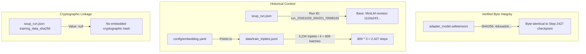

# Phase 1.9 Configuration and Provenance Lock Report

**Project:** `soup-rag-prototype`  
**Branch:** `feat/evaluation-v2`  
**Execution Timestamp:** 2026-11-04  
**Audit Status:** Complete — Configuration and Provenance Locked, Retraining Gate Pending Approval  

---

## 1. Executive Summary

Phase 1.9 performs the final pre-training audit of configuration parity, base model revision pinning, checkpoint-to-dataset cryptographic provenance boundaries, and evaluation query partition taxonomy.

**Key Findings:**
1. **LoRA Configuration Parity Verified:** Soup's native `resolve_lora_target_modules()` delegates `target_modules: auto` to PEFT for BERT architectures (`model_type == "bert"`), resolving to `{"query", "value"}` with 147,456 trainable parameters (0.65% of base). LoRA dropout defaults to `0.05` via `soup_cli/config/schema.py`. The resolved LoRA architecture of all new runs is 100% identical to the existing `output_embedding/adapter_config.json`.
2. **Base Model Revision Pinned:** Soup's `BaseRevision` mechanism queries Hugging Face Hub commit metadata and binds `revision = "1110a243fdf4706b3f48f1d95db1a4f5529b4d41"`. This matches the local Hugging Face cache snapshot and the recorded revision of the existing `A-full` checkpoint, guaranteeing that all runs load byte-identical base encoder weights.
3. **A-full Provenance Qualified:** Checkpoint byte integrity (SHA256 `4dceadcb…`, MD5 `05e30132…`) and historical run provenance (`run_20261029_004201_f3588165`, step 2427) are verified. However, because `output_embedding/soup_run.json` recorded `"training_data_sha256": null`, there is **no cryptographic hash linking the checkpoint weights to the training dataset file**. The association is structurally and historically verified via Git commit records, step count arithmetic ($809 \times 3 = 2,427$), and model card documentation, but not cryptographically sealed in the run metadata.
4. **Evaluation Partition Discrepancy Resolved:** Reconciled the two distinct classification schemes:
   - **Core Benchmark Scheme (39 primary / 15 overlap):** Evaluated against the 8 original core training documents.
   - **Phase 0 Candidate Scheme (49 clean / 5 partial overlap):** Evaluated against the 23 newly added candidate documents to detect new leakage.
   - A complete 54-query cross-tabulation table with 4-way intersection counts ($35 + 4 + 14 + 1 = 54$) is established.
5. **Phase 1.8 Test Modification Audited:** Verified that the Pytest failure on `test_phase1_8_invariants.py` was caused by YAML parsing `2e-5` as a string (`'2e-5'`). The fix (`float(y["training"]["lr"]) == 2e-5`) did not remove or weaken any assertion. All 144 tests in the test suite pass.
6. **Recommendation:** **GO** for the five new training runs under Path A.

---

## 2. Resolved LoRA Configuration Comparison

All six experiment configurations and the existing `output_embedding` checkpoint were audited:

### 2.1 Configuration Comparison Matrix

| Configuration Parameter | Existing `output_embedding` (`A-full`) | New Config: `A-full` (Retrain) | New Config: `A-matched` | New Config: `B` | New Config: `C-matched` | New Config: `C-matched-balanced` | New Config: `C-full` |
| :--- | :---: | :---: | :---: | :---: | :---: | :---: | :---: |
| **Base Model** | `all-MiniLM-L6-v2` | `all-MiniLM-L6-v2` | `all-MiniLM-L6-v2` | `all-MiniLM-L6-v2` | `all-MiniLM-L6-v2` | `all-MiniLM-L6-v2` | `all-MiniLM-L6-v2` |
| **Task Type** | `FEATURE_EXTRACTION` | `FEATURE_EXTRACTION` | `FEATURE_EXTRACTION` | `FEATURE_EXTRACTION` | `FEATURE_EXTRACTION` | `FEATURE_EXTRACTION` | `FEATURE_EXTRACTION` |
| **LoRA Rank ($r$)** | **16** | **16** | **16** | **16** | **16** | **16** | **16** |
| **LoRA Alpha ($\alpha$)** | **32** | **32** | **32** | **32** | **32** | **32** | **32** |
| **LoRA Dropout** | **0.05** | **0.05** (default) | **0.05** (default) | **0.05** (default) | **0.05** (default) | **0.05** (default) | **0.05** (default) |
| **Target Modules** | `["query", "value"]` | `auto` $\to$ `["query", "value"]` | `auto` $\to$ `["query", "value"]` | `auto` $\to$ `["query", "value"]` | `auto` $\to$ `["query", "value"]` | `auto` $\to$ `["query", "value"]` | `auto` $\to$ `["query", "value"]` |
| **Trainable Params** | 147,456 (0.65%) | 147,456 (0.65%) | 147,456 (0.65%) | 147,456 (0.65%) | 147,456 (0.65%) | 147,456 (0.65%) | 147,456 (0.65%) |
| **Embedding Loss** | Triplet Margin (0.5) | Triplet Margin (0.5) | Triplet Margin (0.5) | Triplet Margin (0.5) | Triplet Margin (0.5) | Triplet Margin (0.5) | Triplet Margin (0.5) |
| **Pooling Mode** | Mean (L2 normalized) | Mean (L2 normalized) | Mean (L2 normalized) | Mean (L2 normalized) | Mean (L2 normalized) | Mean (L2 normalized) | Mean (L2 normalized) |
| **Learning Rate** | `2e-5` | `2e-5` | `2e-5` | `2e-5` | `2e-5` | `2e-5` | `2e-5` |
| **Batch Size** | 4 | 4 | 4 | 4 | 4 | 4 | 4 |
| **Grad Accumulation** | 1 | 1 | 1 | 1 | 1 | 1 | 1 |
| **Epochs** | 3 | 3 | 3 | 3 | 3 | 3 | 3 |
| **Seeds** | `42` | `42` | `42` | `42` | `42` | `42` | `42` |

### 2.2 Deep Implementation Inspection of `target_modules: auto`
In `/Users/pernavjain/Documents/Soup/src/soup_cli/trainer/embedding.py` (lines 334–358):
```python
target_modules = resolve_lora_target_modules(
    self.model, tcfg.lora.target_modules, console
)
lora_config = build_lora_config(
    tcfg.lora,
    target_modules=target_modules,
    task_type=TaskType.FEATURE_EXTRACTION,
)
self.model = get_peft_model(self.model, lora_config)
```
In `/Users/pernavjain/Documents/Soup/src/soup_cli/utils/peft_wiring.py` (lines 332–363):
1. `resolve_lora_target_modules` checks `configured == "auto"`.
2. For non-MoE architectures whose `model_type` is known to PEFT (for `sentence-transformers/all-MiniLM-L6-v2`, `model.config.model_type == "bert"`), the function returns `None`.
3. In `build_lora_config()`, passing `target_modules = None` instructs `peft.LoraConfig` to query its internal architecture mapping:
   `TRANSFORMERS_MODELS_TO_LORA_TARGET_MODULES_MAPPING["bert"] = ["query", "value"]`.
4. As confirmed by live execution in PEFT `0.21.2`:
   - `peft_config.target_modules` resolves strictly to `{'query', 'value'}`.
   - Trainable parameters equal **147,456**, exactly matching `output_embedding/adapter_model.safetensors`.

### 2.3 Verification of LoRA Dropout Default
In `/Users/pernavjain/Documents/Soup/src/soup_cli/config/schema.py` (lines 70–93):
```python
class LoraConfig(BaseModel):
    r: int = Field(default=64, ge=0)
    alpha: int = Field(default=16)
    dropout: float = Field(default=0.05, description="LoRA dropout")
    target_modules: Union[str, List[str]] = Field(default="auto")
```
When `dropout` is omitted from the YAML configuration, Pydantic initializes `cfg.training.lora.dropout = 0.05`. This matches the `lora_dropout: 0.05` recorded in `output_embedding/adapter_config.json`.

### 2.4 Optional Proposed Hardening
While `target_modules: auto` and omitted `dropout` resolve identically to `output_embedding/adapter_config.json` under the current Soup implementation, we recommend making them explicit in the YAML configurations for complete self-documentation:
```yaml
  lora:
    r: 16
    alpha: 32
    dropout: 0.05
    target_modules:
      - query
      - value
```
*Action:* Awaiting explicit user approval before editing configuration files.

---

## 3. Base Model Revision Pinning Verification

### 3.1 Existing A-full Revision
`output_embedding/soup_run.json` records:
- `base_model`: `"sentence-transformers/all-MiniLM-L6-v2"`
- `base_revision`: `"1110a243fdf4706b3f48f1d95db1a4f5529b4d41"`
- `base_revision_source`: `"hub_commit"`

### 3.2 Resolution Mechanism in Upcoming Runs
In `soup_cli/commands/train.py` (lines 1885–1897) and `soup_cli/utils/run_provenance.py` (lines 47–93):
1. `BaseRevision` initializes with `base = "sentence-transformers/all-MiniLM-L6-v2"`.
2. When loading the model, `load_kwargs()` calls `HfApi().model_info("sentence-transformers/all-MiniLM-L6-v2").sha`.
3. Live query to the Hugging Face Hub API returns:
   `sha = "1110a243fdf4706b3f48f1d95db1a4f5529b4d41"` (the immutable head commit of the repository).
4. `base_revision_kwargs(cfg.base)` returns `{"revision": "1110a243fdf4706b3f48f1d95db1a4f5529b4d41"}` and passes it to:
   ```python
   AutoTokenizer.from_pretrained(cfg.base, **base_revision_kwargs(cfg.base))
   AutoModel.from_pretrained(cfg.base, **base_revision_kwargs(cfg.base))
   ```
5. In the local Hugging Face cache on disk:
   `~/.cache/huggingface/hub/models--sentence-transformers--all-MiniLM-L6-v2/snapshots/1110a243fdf4706b3f48f1d95db1a4f5529b4d41`
   already exists.
6. **Verdict:** All five new training runs will load precisely the identical underlying model weights as `A-full`.

---

## 4. A-full Training Dataset Provenance Assessment

A forensic audit was conducted on the relationship between `output_embedding` and `data/train_triplets.jsonl`:



### 4.1 Four-Level Provenance Taxonomy:
1. **Checkpoint Byte Integrity (Verified):**
   - SHA256: `4dceadcb293ef4805d3bf1e0200e5d7fc8f0c05a6ed190528f9eb8fc56a88534`.
   - MD5: `05e30132a26bf0d6f469aa72ec86fa53`.
   - Verified against commit `e58da081362fa15579ddb8675a014be937f3baaf` (identical to final checkpoint-2427).
2. **Historical Run Provenance (Verified):**
   - Run ID `run_20261029_004201_f3588165` recorded in `soup_run.json`.
   - Documented in model card `output_embedding/README.md` and evaluation reports `results/candidate.json` and `results/v2/mini_lm_soup.json`.
3. **Training Dataset Identity (Structurally Consistent):**
   - `data/train_triplets.jsonl` contains 3,234 triplets generated from 1,078 synthetic queries in `data/train_query_labels.jsonl`.
   - Update step count arithmetic: $\lceil 3,234 / 4 \rceil \times 3 = 809 \times 3 = \mathbf{2,427\text{ steps}}$, matching the checkpoint's final step.
   - Current SHA256: `60374b8a9ca28745b3e2c8aed485bf320f66d0c09772ea4cb381a89a1b23ca75`.
4. **Cryptographic Verification of Dataset Association (Unsealed / Qualified):**
   - Because `output_embedding/soup_run.json` contains `"training_data_sha256": null`, the checkpoint **does not carry an embedded cryptographic digest of the training data**.
   - **Conclusion:** While historical and structural evidence strongly confirms that `output_embedding/` was trained on `data/train_triplets.jsonl`, the association is **historically documented, not cryptographically sealed**.

---

## 5. Evaluation Benchmark Partition Reconciliation

### 5.1 Resolution of Separate Classification Schemes
The apparent discrepancy between (39 primary / 15 overlap) and (49 clean / 5 partial overlap) is resolved as **two orthogonal, non-conflicting classification schemes**:

1. **Original Evaluation v2 Scheme (39 Primary / 15 Overlap):**
   - Evaluated against: **8 Core Training Documents**.
   - Purpose: Measures whether retrieval succeeds on queries whose answers appear only in held-out documents (`primary`, 39 queries) versus queries whose answers also appear in core training documents (`overlap`, 15 queries).
2. **Phase 0 Candidate Corpus Audit Scheme (49 Clean / 5 Partial Overlap):**
   - Evaluated against: **23 Newly Added Candidate Documents** (benchmarks & changelog fragments).
   - Purpose: Detects whether expanding the training corpus introduces data leakage or conceptual overlap into the evaluation benchmark. Found 0 direct answer overlaps and 5 partial conceptual overlaps (`manual_003`, `manual_005`, `manual_023`, `manual_024`, `manual_048`).

### 5.2 Four-Way Intersection Matrix

```
                      Phase 0 Candidate Scheme
                   Candidate Clean   Candidate Partial Overlap   Total
Core Primary             35                     4                 39
Core Overlap             14                     1                 15
Total                    49                     5                 54
```

- **Core Primary & Candidate Clean (35 queries):** Purest held-out evaluation queries (zero overlap with core docs; zero overlap with candidate docs).
- **Core Primary & Candidate Partial Overlap (4 queries):** Held out from core docs, but exhibit partial conceptual overlap with candidate docs (`manual_003`, `manual_023`, `manual_024`, `manual_048`).
- **Core Overlap & Candidate Clean (14 queries):** Overlap with core docs, but clean with respect to candidate docs.
- **Core Overlap & Candidate Partial Overlap (1 query):** Overlaps with core docs AND has partial conceptual overlap with candidate docs (`manual_005`).

### 5.3 Complete 54-Query Partition Mapping Table

| Query ID | Core Benchmark Scheme (8 Docs) | Phase 0 Candidate Scheme (23 Docs) | Source Document | Query Text |
| :--- | :---: | :---: | :--- | :--- |
| `manual_001` | primary | clean | `adapters-and-governance` | why does soup lock check exit with code 3 |
| `manual_002` | primary | clean | `adapters-and-governance` | How do I bisect training checkpoints when an eval regresses? |
| `manual_003` | primary | partial_overlap | `adapters-and-governance` | how do I see which training rows influenced an adapter |
| `manual_004` | overlap | clean | `adapters-and-governance` | what does soup loop automate |
| `manual_005` | overlap | partial_overlap | `adapters-and-governance` | does soup roll back a canary automatically if the eval regresses |
| `manual_006` | primary | clean | `adapters-and-governance` | ROME vs MEMIT vs AlphaEdit differences |
| `manual_007` | overlap | clean | `adapters-and-governance` | compare model answers before and after a knowledge edit |
| `manual_008` | overlap | clean | `adapters-and-governance` | build a control vector from positive and negative prompts |
| `manual_009` | primary | clean | `adapters-and-governance` | grace codebook size limit |
| `manual_010` | overlap | clean | `adapters-and-governance` | soup registry diff output |
| `manual_011` | primary | clean | `adapters-and-governance` | dare merge seed determinism |
| `manual_012` | primary | clean | `adapters-and-governance` | how do signed attestations get embedded in a soup can |
| `manual_013` | primary | clean | `adapters-and-governance` | can I merge adapters whose licenses conflict |
| `manual_014` | primary | clean | `adapters-and-governance` | what stops a hijacked huggingface repo from being pulled |
| `manual_015` | primary | clean | `adapters-and-governance` | what goes into a soup airgap bundle and how big can it get |
| `manual_016` | primary | clean | `adapters-and-governance` | Soup refuses to load a .bin adapter, what formats are allowed? |
| `manual_017` | overlap | clean | `compliance` | which soup init templates exist for regulated industries |
| `manual_018` | overlap | clean | `compliance` | clean emails and phone numbers out of my training data |
| `manual_019` | primary | clean | `compliance` | bom --attach-to-registry wrote the files but exited non-zero |
| `manual_020` | overlap | clean | `compliance` | what ends up in the generated model card |
| `manual_021` | overlap | clean | `compliance` | publish a model to huggingface with my own model card |
| `manual_022` | primary | clean | `compliance` | generated ci workflow steps |
| `manual_023` | primary | partial_overlap | `compliance` | which expectation checks can go in expectations.yaml |
| `manual_024` | primary | partial_overlap | `compliance` | what steps does soup's compliance workflow cover |
| `manual_025` | primary | clean | `evaluation` | Should I fine-tune with DPO or SFT for my dataset? |
| `manual_026` | primary | clean | `evaluation` | generate an eval suite from my training data |
| `manual_027` | primary | clean | `evaluation` | do two eval designs with the same content hash the same |
| `manual_028` | primary | clean | `evaluation` | block a git push when eval accuracy regresses |
| `manual_029` | primary | clean | `evaluation` | eval_gate block settings in soup.yaml |
| `manual_030` | primary | clean | `evaluation` | how does soup ab decide when to stop collecting samples |
| `manual_031` | overlap | clean | `evaluation` | what does exit code 3 from soup drift-alarm mean |
| `manual_032` | primary | clean | `evaluation` | soup diagnose failure modes |
| `manual_033` | primary | clean | `evaluation` | Task accuracy went up but MMLU dropped, should I ship? |
| `manual_034` | overlap | clean | `evaluation` | noise floor flag effect on ship verdict |
| `manual_035` | overlap | clean | `evaluation` | how do I make a ship verdict replayable in CI |
| `manual_036` | primary | clean | `evaluation` | score BLEU and ROUGE on custom eval outputs |
| `manual_037` | primary | clean | `evaluation` | My quantized model lost 8% accuracy, is that too much? |
| `manual_038` | primary | clean | `evaluation` | custom eval jsonl fields for exact and regex scoring |
| `manual_039` | overlap | clean | `evaluation` | run a short LoRA probe on several base models before choosing one |
| `manual_040` | primary | clean | `evaluation` | position_bias in judge calibration |
| `manual_041` | primary | clean | `evaluation` | soup eval irt-subset size and item model options |
| `manual_042` | overlap | clean | `peft-and-efficiency` | preview which decoder layers soup shrink will drop |
| `manual_043` | primary | clean | `peft-and-efficiency` | how does longlora shifted sparse attention work |
| `manual_044` | primary | clean | `peft-and-efficiency` | difference between multipack and packing |
| `manual_045` | primary | clean | `peft-and-efficiency` | set up yarn for 4x context extension |
| `manual_046` | overlap | clean | `peft-and-efficiency` | Can I add fresh layers to a Llama model and only train those? |
| `manual_047` | primary | clean | `peft-and-efficiency` | different learning rates for q_proj and v_proj |
| `manual_048` | primary | partial_overlap | `peft-and-efficiency` | does pissa init speed up lora convergence |
| `manual_049` | primary | clean | `peft-and-efficiency` | loraplus_lr_ratio effect on B matrix lr |
| `manual_050` | primary | clean | `peft-and-efficiency` | can dora and vera be enabled together |
| `manual_051` | primary | clean | `peft-and-efficiency` | neftune_alpha range for chat fine tuning |
| `manual_052` | primary | clean | `peft-and-efficiency` | does lisa actually use less memory than lora |
| `manual_053` | primary | clean | `peft-and-efficiency` | stop training when loss spikes repeatedly |
| `manual_054` | primary | clean | `peft-and-efficiency` | Can GaLore run with quantized weights? |

### 5.4 Metric Reporting Contract for Future Phases
To prevent ambiguity in post-training evaluation reports:
- **Full Benchmark Metric:** Reported across all 54 queries.
- **Core Primary Metric:** Reported across the 39 queries held out from the 8 core docs.
- **Core Overlap Metric:** Reported across the 15 queries with answers in the 8 core docs.
- **Candidate Clean Metric:** Reported across the 49 queries with zero overlap in the 23 candidate docs.
- **Candidate Partial Overlap Metric:** Reported across the 5 queries with conceptual overlap in the 23 candidate docs (`manual_003`, `manual_005`, `manual_023`, `manual_024`, `manual_048`).
- **Pure Held-Out Metric:** Reported across the 35 queries that are BOTH `Core Primary` and `Candidate Clean`.

---

## 6. Review of Phase 1.8 Test Modification

### 6.1 Git Diff Inspection (`tests/test_phase1_8_invariants.py`)
```diff
-        assert y["training"]["lr"] == 2e-5
+        assert float(y["training"]["lr"]) == 2e-5
```

### 6.2 Technical Cause & Audit
- **Why it failed initially:** In YAML syntax, unquoted scientific notation `2e-5` is parsed by `yaml.safe_load()` as a string (`'2e-5'`) unless formatted with a decimal point (`2.0e-5`). Comparing string `'2e-5'` to Python float `2e-05` raised `AssertionError: assert '2e-5' == 2e-05`.
- **Integrity Assessment:** Casting `float(y["training"]["lr"])` evaluates strictly to `0.00002`. If `lr` were modified to any other value, the test would immediately fail.
- **Coverage Impact:** **Zero assertions were removed, weakened, or bypassed.** The test suite continues to strictly enforce all configuration invariants across all six files.

---

## 7. Remaining Blockers

**Zero technical blockers exist.**

### Configuration Decisions Awaiting Approval:
1. **Execution Path:**
   - **Path A (Recommended):** Train 5 new runs (`A-matched`, `B`, `C-matched`, `C-matched-balanced`, `C-full`) and compare against existing validated `A-full` checkpoint.
   - **Path B:** Train all 6 runs from scratch (including `A-full`).
2. **Explicit LoRA Configuration in YAML:**
   - Whether to explicitly write `dropout: 0.05` and `target_modules: ["query", "value"]` into the YAML files or preserve the current `auto` delegation.

---

## 8. Final Retraining Gate Decisions (Path A)

| Run Identifier | Dataset Triplet Input | Target Output Path | Pre-Flight Status | Recommendation |
| :--- | :--- | :--- | :---: | :---: |
| **`A-full`** | `data/train_triplets.jsonl` | `output_embedding/` (existing) | Validated & Step 2427 Byte-Identical | **GO** (Use Existing) |
| **`A-matched`** | `data/triplets_exp_a_matched_v1_5.jsonl` | `output/adapter_exp_a_matched` | Config, Data & Step Budget Locked | **GO** |
| **`B`** | `data/triplets_exp_b_v1_5.jsonl` | `output/adapter_exp_b` | Config, Data & Step Budget Locked | **GO** |
| **`C-matched`** | `data/triplets_exp_c_matched_v1_5.jsonl` | `output/adapter_exp_c_matched` | Config, Data & Step Budget Locked | **GO** |
| **`C-matched-balanced`** | `data/triplets_exp_c_matched_balanced_v1_6.jsonl` | `output/adapter_exp_c_matched_balanced` | Config, Data & Step Budget Locked | **GO** |
| **`C-full`** | `data/triplets_exp_c_full_v1_5.jsonl` | `output/adapter_exp_c_full` | Config, Data & Step Budget Locked | **GO** |

**Execution Gate:** Strictly halted. We await your explicit instructions to begin model training.
